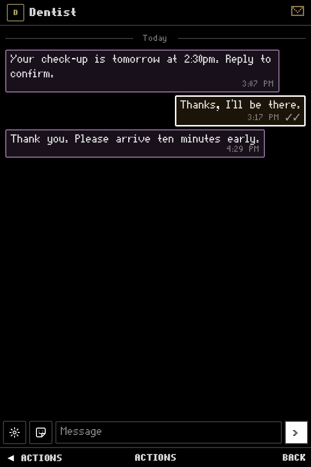

# DumbTalk for Android

Signal, Telegram, WhatsApp and SMS in one inbox, built for Android keypad phones and driven
entirely with the D-pad. Use it as your **default SMS app**, with everyday texts beside your
Signal, Telegram and WhatsApp chats. Every messaging network runs on the phone itself: there's no server, no
account with us and no tracking.

> **Status: early.** Daily use works on all three networks (text, replies, reactions, edits,
> photos, stickers, voice notes, files, polls, groups). Some newer features haven't been tested
> with real accounts yet; see [what works](#what-works).

DumbTalk is unofficial and is not affiliated with Signal, Telegram or WhatsApp.

Part of the Dumb family of keypad apps: [DumbPhone](https://github.com/samtate/dumbphone-android) · [DumbContacts](https://github.com/samtate/dumbcontacts-android) · **DumbTalk** · [DumbMail](https://github.com/samtate/dumbmail-android) · [DumbClock](https://github.com/samtate/dumbclock-android) · [DumbCamera](https://github.com/samtate/dumbcamera-android) · [DumbHome](https://github.com/samtate/dumbhome-android) · [DumbSparky](https://github.com/samtate/dumbsparky-android).

<table>
  <tr>
    <td align="center"><br><sub>Unified inbox</sub></td>
    <td align="center"><br><sub>Conversation</sub></td>
    <td align="center"><br><sub>SMS conversation</sub></td>
  </tr>
  <tr>
    <td align="center"><br><sub>Menu</sub></td>
    <td align="center"><br><sub>Services</sub></td>
    <td align="center"><br><sub>Message actions</sub></td>
  </tr>
</table>

## Phones

Any Android 10 (API 29) or newer phone with a 64-bit ARM (arm64-v8a) processor. It's designed
around keypad phones with a D-pad and softkeys, and tested on the **Qin F22 Pro** (640×960). It
also works by touch on ordinary phones.

## Install

1. Download the APK from the [latest release](../../releases/latest), or add this repository to
   [Obtainium](https://github.com/ImranR98/Obtainium) to get updates automatically.
2. Install it (allow installing from your browser or Obtainium when Android asks).
3. Open DumbTalk. It asks which key opens menus (once for every Dumb app), a short welcome
   explains the keys, then it asks to allow notifications and to run in the background.
   Allow both, or messages arrive late.
4. Choose **Connect a service**, or **Try the demo** to try all four services, including SMS,
   with made-up chats first. The demo never sends real texts or changes your default SMS app.
5. To use real SMS, open **Settings → Services → SMS → Make default SMS app** and accept
   Android's role and permission prompts. Signal, Telegram and WhatsApp are linked separately.

## Keys

| Key | Action |
| --- | --- |
| ▲ ▼ | Move |
| Centre | Open the focused item, or the action shown in the middle (Type, Send, …) |
| ◀ (D-pad Left) | The left softkey: Menu in the inbox, a message's actions in a chat |
| Back / right softkey | Back |

DumberOS keeps the phone's real left softkey for its notification shade, so D-pad Left stands in
for it wherever the screen doesn't need Left itself; the softkey bar marks it with ◀. Text boxes,
side-by-side buttons and the photo viewer keep Left for moving.

In a chat the newest message starts selected: Centre gives it a quick 👍, ◀ opens its actions
(reply, react, forward, …) and Down from the newest message reaches the message box. Typing uses
the phone's keypad keyboard (such as TT9); Centre sends once there's text, and Back leaves the
text box. **◀ Menu → Settings → Keys & help** shows the keys on the phone.

## SMS: your phone's text messages

DumbTalk can be your default SMS app: **Settings → Services → SMS → Make default SMS app**.
Your existing texts then appear in the same inbox as Signal, Telegram and WhatsApp, with an SMS
badge so you can tell them apart. SMS uses your phone's mobile service and default SMS SIM;
you don't need to link an account. Your carrier's usual text charges apply.

- Read existing texts, start a conversation and send plain text, including long and Unicode messages.
- Search texts, mute conversations and delete messages or conversations.
- Get incoming-message notifications with **Reply** and **Mark read** actions.
- See sent, delivered and failed states, and retry a failed text. SMS has no read receipts.

Your texts stay in **Android's message store**, so choosing another default SMS app later keeps
them. They aren't included in DumbTalk's encrypted backups. **MMS and RCS aren't supported**;
SMS doesn't have photo attachments, reactions, quoted replies or group chat features.

Incoming SMS is handled by a small separate process that doesn't start the other networks.
Messages that arrive before the phone is first unlocked are kept until it is.

**Try it safely:** the demo includes made-up SMS conversations alongside the three messaging
networks. Demo texts stay in memory and never reach a SIM, a carrier or your real message store.

## Linking accounts

For Signal, Telegram and WhatsApp, DumbTalk links to your existing accounts as an extra device,
the way the desktop apps do. Your main phone stays the main device.

- **Signal** links only by scanning a QR code, by design. If Signal (or Molly) is on the same
  phone, show the code on another screen and scan it from there. Signal doesn't copy old messages
  to new devices, so chats start from when you link.
- **Telegram** links by QR, or by phone number with a code sent to your other Telegram devices.
  It needs app credentials of your own, once: on a computer, sign in at
  [my.telegram.org](https://my.telegram.org), open **API development tools**, create an app (any
  name and platform) and enter its **App api_id** and **App api_hash** when DumbTalk asks.
- **WhatsApp** links by QR, or by phone number with a pairing code. The pairing code works with
  WhatsApp on the same phone.

Things to know:

- **WhatsApp signs linked devices out after about 14 days** without your main phone online, and
  **Signal unlinks devices after about 30 days** it hasn't heard from them. Link again if it
  happens.
- **Unofficial clients carry some risk of an account ban**, especially on WhatsApp.
- **Back up before you rely on it.** Disconnecting a service, uninstalling or resetting the phone
  deletes DumbTalk's copy of your messages unless you have a backup (see below). Your chats stay
  on your main phone (and Telegram's servers), except Signal messages received only by DumbTalk.

## Sending

For Signal, Telegram and WhatsApp, a message appears in the chat the moment you send it, with a
clock, and DumbTalk sends it once in the background, in order. If it can't be sent it stays in the chat with a red **!** and the
reason; **◀ → Retry send** sends it again under the same ID, so if the first attempt got through
after all, nobody sees it twice. While a network is offline the chat says so, and messages wait
(up to five minutes) for the connection instead of failing.

## Notifications, online status and receipts

- Each chat's notification has **Reply** and **Mark read**, so you can answer without opening
  DumbTalk. A chat read elsewhere (on your main phone, say) clears its notification.
- Each network has its own notification channel ("Signal messages", …), so you can give them
  different sounds or silence one in Android's settings. On Android 11+ chats appear in the
  shade's Conversations section. The lock screen shows only "New message" unless you allow more.
- The ongoing "Connected" notification is silent and kept apart at the bottom of the shade; it
  names any network that's offline.
- A one-to-one chat shows **online** or **last seen** under its name, and **Group info** shows it
  for each member, on Telegram and WhatsApp. Signal doesn't share this with anyone.
- **◀ on your message** lists each recipient with when it was **delivered**, **read** and
  **played**: in a group, exactly who has read it. Telegram only tells read times (for small
  groups, for a week, and in private chats where both people show read times).

## Backup and moving phones

**◀ Menu → Settings → Back up** saves an encrypted copy of DumbTalk (your chats, linked accounts
and settings, and optionally photos and files) to a file you choose, such as on an SD card. It's
encrypted with a passphrase you pick; without it the backup can't be opened, so keep it safe.

To move to a new phone, install DumbTalk there and choose **Restore from backup** on the first
screen (or in Settings). Then **remove DumbTalk from the old phone**: the same linked device
running on two phones breaks its WhatsApp and Signal sessions. SMS isn't in backups; it stays in
Android's own message store.

## Privacy

- Each network runs on the phone: Signal through [presage](https://github.com/whisperfish/presage),
  Telegram through [TDLib](https://github.com/tdlib/td) and WhatsApp through
  [whatsmeow](https://github.com/tulir/whatsmeow). SMS uses Android's telephony APIs and your SIM.
- Signal, Telegram and WhatsApp messages, media and keys stay in DumbTalk's private app storage.
  SMS stays in Android's message store. Android backup is turned off
  so they're never copied off the phone.
- There's no analytics or crash reporting. **Settings → Share debug log** sends a log only when
  you choose to; it can contain names and numbers, so read it before posting it publicly.

## Staying connected

Signal, Telegram and WhatsApp do not push messages to DumbTalk, so DumbTalk keeps one connection
per network open in a foreground service (the ongoing "DumbTalk" notification). It reconnects when
the network changes, checks every 15 minutes even in Doze, and checks again whenever you open the
app.

If messages arrive late:

1. **Settings → Background delivery** should say "On". If not, select it to fix the battery
   setting; "Restricted" battery use stops background delivery completely.
2. **Settings → Services** shows each network as On, Offline (linked but not connected right now)
   or Off.
3. Some phones kill background apps aggressively; see [dontkillmyapp.com](https://dontkillmyapp.com).

## What works

| | Signal | Telegram | WhatsApp | SMS |
| --- | --- | --- | --- | --- |
| Plain text | ✅ | ✅ | ✅ | ✅ |
| Quoted replies, reactions, edits | ✅ | ✅ | ✅ | ❌ |
| Delete messages | ✅ | ✅ | ✅ | ✅ (local) |
| Photos, videos, stickers, voice notes, files | ✅ | ✅ | ✅ | ❌ |
| Search, contacts, new chats, mute, archive | ✅ | ✅ | ✅ | search, new texts, mute; no archive |
| Old messages after linking | ❌ (Signal's design) | ✅ | ✅ (recent, from your phone) | ✅ (Android's SMS store) |
| Pinned messages | ✅ ¹ | ✅ | ✅ ¹ | ❌ |
| Polls | ✅ ¹ | ✅ | ✅ ¹ | ❌ |
| Mentions, formatting, disappearing messages | ✅ ¹ | ✅ ¹ | ✅ ¹ | ❌ |
| Message requests, blocking | ✅ ¹ | ✅ ¹ | blocking only ¹ | ❌ |
| Groups: create, rename, add, remove, leave | ✅ ¹ | ✅ ¹ | ✅ ¹ | ❌ |
| Online / last seen | ❌ (not shared) | ✅ | ✅ ¹ | ❌ |
| Who read it, and when (groups too) | ✅ ¹ | read only | ✅ ¹ | delivery status only |
| Calls | ❌ | ❌ | ❌ | ❌ |

¹ Built but not yet tested with a real account. Forward messages between Signal, Telegram and
WhatsApp chats, or forward their text to SMS. See [docs/plan.md](docs/plan.md) for details and what's next.

## Reporting a problem

Open an issue with your phone model, Android version and DumbTalk version (**Settings → About**).
For anything about messages not arriving, attach **Settings → Share debug log** after checking it
for anything private.

## Build

You need JDK 17, the Android SDK (platform 35) with NDK **27.2.12479018**, Go 1.26+, and for the
Signal bridge rustup (it installs the pinned Rust 1.99 itself), `cargo install cargo-ndk`, CMake,
Ninja, clang/libclang and protoc. Set `ANDROID_HOME` and `ANDROID_NDK_HOME`.

Build the three native pieces first. Gradle won't configure the project until the Signal bridge
exists. If `cargo test` has already built the Signal bridge's dependencies with another CMake
generator, build it with the same one (CI uses `CMAKE_GENERATOR="Unix Makefiles"`).

```sh
scripts/fetch-tdlib.sh       # Telegram: TDLib from this repo's TDLib release
scripts/build-wabridge.sh    # WhatsApp: Go bridge via gomobile
scripts/build-sigbridge.sh   # Signal: Rust bridge via cargo-ndk + UniFFI
./gradlew :core:testDebugUnitTest :app:testDebugUnitTest   # unit and keypad tests
./gradlew :app:assembleDebug                               # app/build/outputs/apk/debug/
```

Debug builds are a separate app (`dev.dumbtalk.app.debug`) signed with a committed key, so they
install over each other and alongside a release. Local builds have version code 1; to install one
over a newer CI build use `adb install -r -d`.

To skip typing Telegram credentials on the phone during development, put your own in
`local.properties` (never committed):

```properties
telegram.api_id=12345678
telegram.api_hash=0123456789abcdef0123456789abcdef
```

The screenshots above use made-up data from all four demo services. `KeypadFlowTest` drives
both messaging and SMS flows with hardware key events at 640×960. Refresh them with:

```sh
./gradlew :app:testDebugUnitTest --tests '*KeypadFlowTest' -Proborazzi.test.record=true
```

A separate **DumbTalk DEMO** APK (`dev.dumbtalk.app.demo`) installs beside the real app:
`./gradlew :app:assembleDemo`. All four services use in-memory demo data; no accounts,
SMS permissions or default-app changes are needed.

### Releases

CI tests and builds a debug APK on every push. Pushing a `v*` tag (for example `v0.1.0`) also
builds a signed release APK and publishes it as a GitHub release; the version name comes from the
tag. Release signing needs the repository secrets `DUMBTALK_KEYSTORE_BASE64`,
`DUMBTALK_KEYSTORE_PASSWORD`, `DUMBTALK_KEY_ALIAS` and `DUMBTALK_KEY_PASSWORD`. TDLib is built by
its own workflow only when `tdlib.properties` changes.

## Layout

- `core/`: the messaging contract every network implements (`Contracts.kt`), the merged inbox
  (`Inbox.kt`), the shared half of the two native bridges (`bridge/`) and the demo service.
- `app/`: the Compose keypad UI. `ui/Softkeys.kt` is the softkey model and `ui/Components.kt`
  the focus handling; `background/` holds the connection service and notifications; `sms/` the
  SMS client.
- `svc-telegram/`: Telegram on TDLib. `svc-whatsapp/` + `bridge/whatsapp/`: a Go bridge on
  whatsmeow. `svc-signal/` + `bridge/signal/`: a Rust bridge on presage. Both bridges keep their
  own SQLite store of chats and messages and return JSON.

## Licence

AGPL-3.0. The Signal integration builds on AGPL-licensed Signal code.

The interface font is "Dot Matrix" by Svein Kåre Gunnarson (Dionaea Fonts), distributed as
freeware. Characters it lacks (accents, symbols, emoji, other scripts) use a subset of
[GNU Unifont](https://unifoundry.com/unifont/) 17.0.05, dual-licensed under the SIL Open Font
License 1.1 and GPL 2+ with the font embedding exception.
