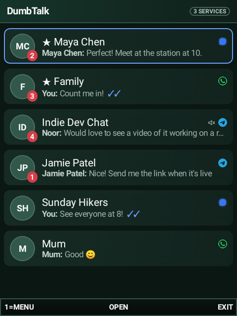
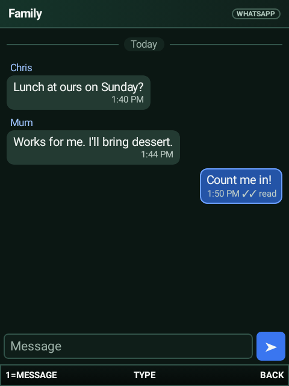
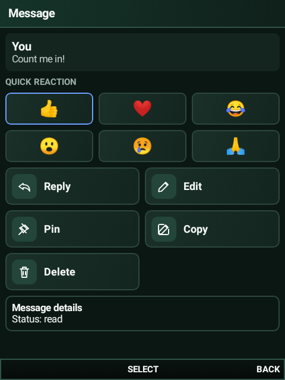
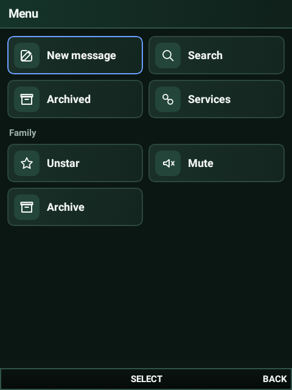
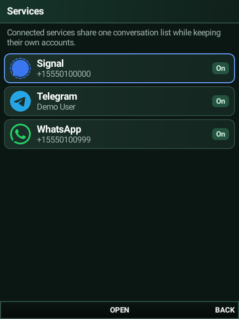
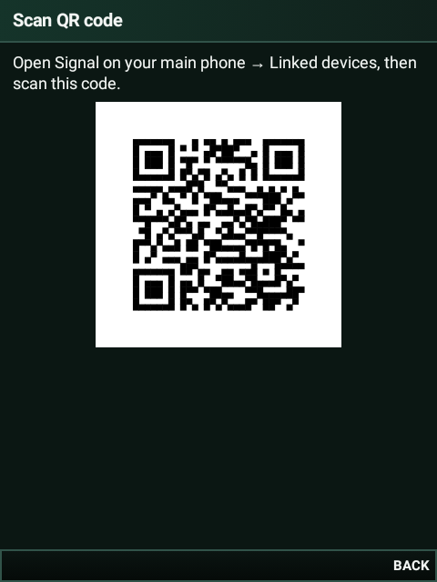

# DumbTalk for Android

A native, D-pad-first Signal, Telegram and WhatsApp client for Android keypad phones such as the
Qin F22 Pro. It is the successor to the self-hosted [dumbtalk](https://github.com/samtate/dumbtalk)
server: the same keypad interface, but every messaging service runs on the phone itself. No server is
needed.

> **Status: early development.** The keypad UI shell runs against built-in demo services. The real
> network services are coming one at a time: Telegram first, then WhatsApp, then Signal. See
> [docs/plan.md](docs/plan.md).

DumbTalk is unofficial and is not affiliated with Signal, Telegram or WhatsApp.

<table>
  <tr>
    <td align="center"><br><sub>Unified inbox</sub></td>
    <td align="center"><br><sub>Conversation</sub></td>
    <td align="center"><br><sub>Message actions</sub></td>
  </tr>
  <tr>
    <td align="center"><br><sub>Menu</sub></td>
    <td align="center"><br><sub>Services</sub></td>
    <td align="center"><br><sub>Linking</sub></td>
  </tr>
</table>

The screenshots come from the Robolectric keypad test (`KeypadFlowTest`), which drives the app with
hardware key events at the Qin F22 Pro's screen size.

## Keys

| Key | Action |
| --- | --- |
| D-pad | Move focus |
| Centre / Enter | Activate the focused item, or the centre softkey action (Type, Send, …) |
| Left softkey, Menu or **1** | Left softkey action (**1** types a digit while a text field is focused) |
| Right softkey or Back | Right softkey action (Back, Cancel, Exit) |

On the Qin F22 Pro, DumberOS may claim Menu for its notification panel. Use 1 or the left softkey
instead, or move the panel shortcut in DumberOS settings.

## Install

Every push to `main` builds a debug APK in GitHub Actions; download the `dumbtalk-debug` artifact from
the latest run and install it:

```sh
adb install -r app-debug.apk
```

Debug builds share one committed signing key, so each new debug APK installs over the previous one.
They also show demo conversations.

Tagged releases (`v*`) publish a signed release APK on the Releases page, which Obtainium can track.
Release signing requires these repository secrets: `DUMBTALK_KEYSTORE_BASE64`,
`DUMBTALK_KEYSTORE_PASSWORD`, `DUMBTALK_KEY_ALIAS` and `DUMBTALK_KEY_PASSWORD`.

## Build

You need JDK 17 and the Android SDK (platform 35).

```sh
./gradlew :core:testDebugUnitTest :app:testDebugUnitTest   # unit and keypad tests
./gradlew :app:assembleDebug                               # app/build/outputs/apk/debug/
./gradlew :app:testDebugUnitTest -Proborazzi.test.record=true  # refresh docs/screenshots
```

## Layout

- `core/`: the universal messaging contract (`Contracts.kt`), the multi-service inbox
  (`Inbox.kt`) and the demo service. It is ported from the web client's `contracts.ts`.
- `app/`: the Compose keypad UI. `ui/Softkeys.kt` ports the softkey stack, and `ui/Components.kt`
  holds the focus treatment.
- Services will live in their own modules (`svc-telegram`, `svc-whatsapp`, `svc-signal`).

## Licence

AGPL-3.0. The Signal integration builds on AGPL-licensed Signal code.
